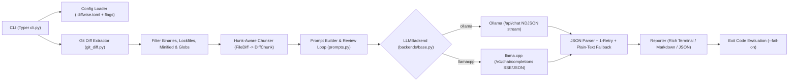

# diffwise

> **Local, private, zero-cost AI code review for staged Git diffs before commit.**

[](https://www.python.org/downloads/)
[](LICENSE)
[-111827)](#backends)
[](https://docs.astral.sh/ruff/)
[](https://mypy-lang.org/)

`diffwise` inspects your staged Git changes (or commit ranges) using a **local LLM** running on your own machine through **Ollama** or **llama.cpp**. No cloud API keys, no source code leaving your laptop, and zero per-token cost.

It outputs severity-ranked findings (`security`, `bug`, `style`, `suggestion`) with syntax-highlighted diff snippets in your terminal, or exports Markdown/JSON reports, and can block broken or insecure commits via `--fail-on` and `pre-commit`.


---

## Why diffwise?

- **100% Local & Private:** Code never leaves `localhost`. Works offline on airplanes, corporate networks, and proprietary repositories.
- **Zero Cost:** Uses local quantized coder models such as `qwen2.5-coder:7b` (or `qwen2.5-coder:3b` on `< 8 GB` RAM machines).
- **Noise Filtering Built In:** Automatically skips binary files, lockfiles (`package-lock.json`, `poetry.lock`, `uv.lock`, `Cargo.lock`, etc.), minified bundles (`*.min.js`, long single-line files), user ignore globs, and oversized files, then chunks large diffs by hunk group to stay inside local model context windows.
- **Resilient Structured Output:** Enforces a strict JSON schema from the LLM, strips accidental Markdown code fences, retries once automatically on invalid JSON, and falls back to plain-text notes instead of crashing your commit hook.
- **Commit Gating & Exports:** Block commits cleanly with `--fail-on bug` or `--fail-on security`, or write Markdown/JSON reports for pull request summaries and CI artifacts.

---

## Prerequisites & Installation

### 1. Install Git and a Local LLM Runtime

- **Git** (`2.x+`) and **Python** (`3.10+`)
- **Ollama** (recommended): [ollama.com](https://ollama.com)

Pull a local coder model and start the Ollama server:

```bash
# Recommended for machines with >= 8 GB RAM
ollama pull qwen2.5-coder:7b

# Smaller alternative for < 8 GB RAM
ollama pull qwen2.5-coder:3b

# Start the local server (if not already running as a background service)
ollama serve
```

> [!NOTE]
> `diffwise` also supports any `llama.cpp` server (`llama-server`) exposing the OpenAI-compatible `/v1/chat/completions` endpoint via `--backend llamacpp`.

### 2. Install `diffwise`

From PyPI (once published):

```bash
pip install diffwise
```

From source (current repository):

```bash
git clone <repository-url>
cd diffwise
python -m venv .venv
# Linux / macOS:
source .venv/bin/activate
# Windows PowerShell:
.\.venv\Scripts\Activate.ps1

pip install -e ".[dev]"
```

---

## Quickstart

Initialize a `.diffwise.toml` in your repository root:

```bash
diffwise init
```

Stage a change and review it before committing:

```bash
git add app.py
diffwise
```

Fail the command (exit code `1`) if any `bug` or `security` issue is found:

```bash
diffwise --staged --fail-on bug
```

Review an existing commit or branch range instead of the staging area:

```bash
diffwise --commit HEAD
diffwise --commit main..HEAD
```

Write a Markdown or JSON report to a file:

```bash
diffwise --format markdown --output review.md
diffwise --format json --output review.json
```

Use the `llama.cpp` backend:

```bash
diffwise --backend llamacpp --model qwen2.5-coder-7b
```

### Pre-commit Integration

This repository ships a [`.pre-commit-hooks.yaml`](.pre-commit-hooks.yaml) definition (`args: [--staged, --fail-on, bug]`). Add it to your project's `.pre-commit-config.yaml`:

```yaml
repos:
  - repo: <repository-url>
    rev: v0.1.0
    hooks:
      - id: diffwise
```

---

## Configuration Reference

`diffwise` looks for configuration in this order:
1. `--config PATH` passed explicitly on the CLI
2. `.diffwise.toml` in `--repo` (or current working directory) and its parent directories
3. Built-in defaults

**CLI flags always override `.diffwise.toml`.**

### `.diffwise.toml` Options

| Key | Type | Default (`DiffwiseConfig`) | `diffwise init` Starter | Description |
| :--- | :--- | :--- | :--- | :--- |
| `model` | `str` | `"qwen2.5-coder:7b"` | `"qwen2.5-coder:7b"` | Model identifier sent to Ollama or llama.cpp |
| `backend` | `str` | `"ollama"` | `"ollama"` | LLM backend (`"ollama"` or `"llamacpp"`) |
| `ollama_url` | `str` | `"http://localhost:11434"` | `"http://localhost:11434"` | Base URL for the Ollama HTTP API (`http://` or `https://`) |
| `llamacpp_url` | `str` | `"http://localhost:8080"` | `"http://localhost:8080"` | Base URL for `llama.cpp` server (`http://` or `https://`) |
| `timeout_seconds` | `float` | `120.0` | `120.0` | Request timeout in seconds (`> 0`) |
| `max_file_size_bytes` | `int` | `100000` | `100000` | Skip files whose diff exceeds this size in bytes |
| `max_chunk_chars` | `int` | `12000` | `12000` | Maximum prompt diff characters per LLM chunk |
| `fail_on` | `str` | `"none"` | `"bug"` | Failure threshold (`"bug"`, `"security"`, or `"none"`) |
| `ignore_globs` | `list[str]` | `[]` | `["dist/**", "build/**", "*.snap", "*.generated.*"]` | Extra glob patterns to exclude from review |
| `rules` | `list[str]` | `[]` | 3 starter security/error rules | Custom review instructions appended to the system prompt |

### CLI Reference

| Option / Command | Description |
| :--- | :--- |
| `diffwise init [--path DIR] [--force]` | Create a starter `.diffwise.toml` file |
| `--model`, `-m TEXT` | Local LLM model name |
| `--backend`, `-b [ollama\|llamacpp]` | Backend server adapter |
| `--format`, `-f [terminal\|markdown\|json]` | Output report format (default: `terminal`) |
| `--output`, `-o PATH` | Write report to `PATH` instead of stdout |
| `--fail-on [bug\|security\|none]` | Exit `1` on matching findings (`bug` threshold includes `security`) |
| `--staged` | Review staged Git changes (default when `--commit` is omitted) |
| `--commit`, `-c REF` | Review a commit or revision range (mutually exclusive with `--staged`) |
| `--repo PATH` | Target Git repository path (defaults to cwd) |
| `--config PATH` | Explicit `.diffwise.toml` path |
| `--version` | Print installed version and exit |

**Exit Codes:** `0` = passed / empty staging area / `--fail-on none`; `1` = findings met `--fail-on` threshold (or `init` target exists without `--force`); `2` = configuration, CLI usage, Git repository, or backend error.

---

## Architecture



---

## Benchmark

`diffwise` includes a real-world benchmark suite under [`benchmark/`](benchmark/run_benchmark.py) containing **14 small diffs**, each seeded with a known defect (SQL injection, hardcoded secret, off-by-one, command injection, path traversal, resource leak, TOCTOU race, etc.).

Run it yourself against any local model:

```bash
python benchmark/run_benchmark.py --model qwen2.5-coder:7b --backend ollama
```

### Measured Results (`qwen2.5-coder:7b`, Ollama)

Copied directly from [`benchmark/RESULTS.md`](benchmark/RESULTS.md):

- **Date:** 2026-11-11 01:00 UTC
- **Backend:** `ollama` | **Model:** `qwen2.5-coder:7b`
- **Cases:** 14 | **Caught:** 7/14 (50.0%) | **Exact Severity Match:** 6/14 | **Missed:** 7/14
- **False Positives (non-seeded findings):** 2 | **Total Runtime:** 145.1s (avg 10.4s/diff)

| ID | Category | Expected Severity | Status | Findings | Matched Finding | False Positives | Latency |
| :--- | :--- | :--- | :--- | :---: | :--- | :---: | :---: |
| `01_sql_injection` | Security | `security` | Caught | 1 | `[security] L11: SQL Injection Vulnerability in get_user Function` | 0 | 14.2s |
| `02_hardcoded_secret` | Security | `security` | Caught | 1 | `[security] L1: Hardcoded Secret Key` | 0 | 10.9s |
| `03_off_by_one` | Bug | `bug` | Caught | 1 | `[bug] L3: Incorrect range in loop` | 0 | 14.7s |
| `04_unhandled_exception` | Bug | `bug` | Missed | 0 | `-` | 0 | 5.8s |
| `05_command_injection` | Security | `security` | Caught | 1 | `[security] L6: Command Injection Risk in ping_host` | 0 | 13.5s |
| `06_path_traversal` | Security | `security` | Missed | 1 | `-` | 1 (`[security] L3: Hardcoded file path`) | 11.2s |
| `07_resource_leak` | Bug | `bug` | Caught | 1 | `[bug] L10: Potential Resource Leak: Unclosed File Handle` | 0 | 15.8s |
| `08_mutable_default` | Bug | `bug` | Missed | 0 | `-` | 0 | 5.7s |
| `09_null_dereference` | Bug | `bug` | Missed | 0 | `-` | 0 | 5.9s |
| `10_dom_xss` | Security | `security` | Missed | 0 | `-` | 0 | 5.8s |
| `11_toctou_race` | Bug | `bug` | Missed | 1 | `-` | 1 (`[bug] L15: Unnecessary balance update`) | 11.7s |
| `12_infinite_loop` | Bug | `bug` | Missed | 0 | `-` | 0 | 5.9s |
| `13_weak_password_hash` | Security | `security` | Caught | 1 | `[security] L7: Weak Password Hashing Algorithm` | 0 | 11.8s |
| `14_missing_timeout` | Bug | `bug` | Caught (suggestion) | 1 | `[suggestion] L12: Add a timeout to requests.post` | 0 | 12.2s |

---

## Limitations

Small local models (`7B` quantized weights) trade deep reasoning for speed and privacy. Be realistic about what `diffwise` can and cannot catch:

- **Substantial miss rate on subtle semantics (7/14 missed above):** In our benchmark on `qwen2.5-coder:7b`, obvious pattern bugs (f-string SQL injection, `shell=True` command injection, MD5 password hashing, hardcoded secrets, unclosed `open()`) were reliably caught, while subtler flaws were missed: path traversal (`os.path.join` without containment check), Python mutable default arguments (`tags: list[str] = []`), unguarded nullable dereference (`user["name"]`), DOM XSS (`innerHTML`), TOCTOU check-then-act races, missing error handling, and `while` loop termination mistakes.
- **Diff-only local context:** Each prompt contains only one hunk-grouped diff chunk from a single file — the model cannot inspect definitions, callers, schemas, or types across other files in your repository.
- **False positives and severity drift:** Across the 14 benchmark diffs, the model produced 2 false positives (flagging safe code lines) and downgraded `14_missing_timeout` from `bug` to `suggestion` (meaning `--fail-on bug` would not block it).
- **Non-determinism & hardware latency:** Even at low temperature, outputs can vary between runs, and cold-starting or running on CPU-only laptops adds noticeable delay to `git commit` (~10.4s average per diff on an RTX 3050 Ti 4 GB laptop GPU).

Use `diffwise` as an automated **fast second pair of eyes** alongside deterministic linters/typecheckers (`ruff`, `mypy`, `bandit`, `semgrep`), automated tests, and human code review — never as your sole security gate.

---

## Development

Run linting, strict type checking, and the mocked unit test suite locally:

```bash
ruff check src tests benchmark/run_benchmark.py
mypy src tests
pytest -v --cov=diffwise --cov-report=term-missing
```

## License

MIT — see [LICENSE](LICENSE).
